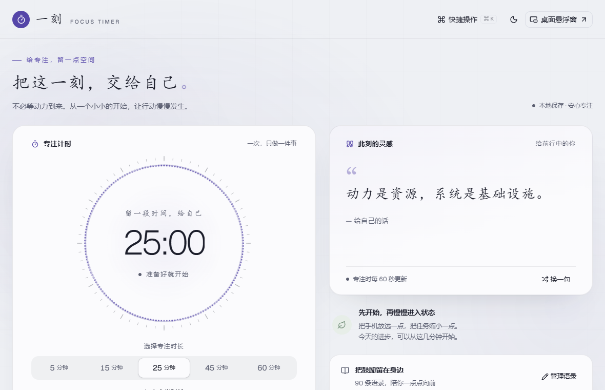

# 一刻 · 激励学习计时器

一个安静的专注计时器：选一个时长，开始，专注，结束时给你一句鼓励。不需要注册账号，所有数据只留在你自己的电脑或浏览器里。



## 下载

**Windows 桌面版**：前往 [Releases 页面](../../releases/latest)，下载并运行安装包（`一刻_*_x64-setup.exe`）。

> 安装包目前没有做代码签名，Windows 可能会弹出 SmartScreen 提示"Windows 已保护你的电脑"。点击"更多信息" → "仍要运行"即可继续安装。这是因为签名证书需要付费购买，不代表软件本身有问题。

**网页版**：暂时没有托管好的在线地址，想试用可以按下方"自己跑起来"在本机运行。

## 功能

- **专注计时**：5 / 15 / 25 / 45 / 60 分钟预设，或自定义时长；支持暂停、继续、重置。
- **激励语录**：专注时定时轮换一句鼓励的话，内置约 90 条，也可以自己新增、编辑、删除。
- **桌面悬浮窗**（仅桌面版）：一个独立的、始终置顶的小窗口，关掉主窗口也能继续看时间，不打断你手头的其他工作。
- **系统托盘**（仅桌面版）：关闭主窗口只是收到托盘里，计时不会中断，到点照常提醒；再次打开只会唤起同一个程序，不会开出第二个窗口。
- **深色模式**，跟随你的喜好切换。
- **完全离线、不建账号**：计时、语录、设置都只保存在本机，没有服务器，没有数据上传。

## 使用方法

1. 选一个时长，点"开始专注"。
2. 需要暂停就暂停，想重新开始就重置。
3. 结束时会有提示音和系统通知（可以在设置里关掉提示音）。
4. 想让计时一直显示在桌面上，点"桌面悬浮窗"。

语录看腻了可以点"换一句"，也可以在"管理语录"里加入你自己想看到的句子。

## 系统要求

- **桌面版**：Windows 10 或 11（64 位）。首次运行如果系统里没有 WebView2 组件，安装包会自动下载安装，需要联网。
- **网页版**：现代浏览器（Chrome、Edge、Firefox、Safari 均可）；"桌面悬浮窗"在网页版里走浏览器自带的画中画功能，需要 Chrome / Edge 116 及以上版本。

## 常见问题

**数据会丢吗？** 不会联网同步，但也没有云端备份——换一台电脑、清除浏览器数据，或者卸载桌面版，本地记录都会跟着消失。

**支持 Mac / Linux 吗？** 暂时只有 Windows 安装包。网页版理论上哪个系统都能打开，只是"桌面悬浮窗"这个功能需要前面说的浏览器画中画支持。

**会收集我的使用数据吗？** 不会。整个应用不连接任何服务器，没有统计、没有账号、没有广告。

## 自己跑起来

```sh
npm install
npm run dev
```

打开终端给出的地址（默认 http://localhost:5173）即可。想了解代码结构、桌面版打包方法或参与开发，看 [DEVELOPMENT.md](DEVELOPMENT.md)。
